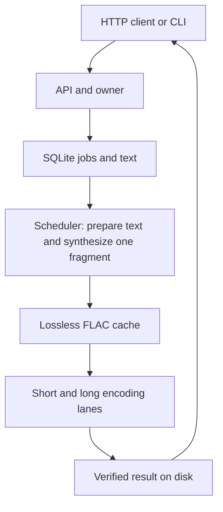

# Architecture and development

[Project](../../README.md) · [Documentation](../README.md) · [Русский](../ru/development.md)

## Follow a request



One process owns one model and one SQLite connection. Model loading, bounded text preparation and inference use one executor thread. The async scheduler alternates fragments across jobs. SQLite is accessed by the event loop; the model executor never uses its connection. Two encoder threads provide separate short/long lanes, with at most two FFmpeg processes assembling results.

| Source | Responsibility |
|---|---|
| `app/main.py` | Request schemas, owner authorization, HTTP compatibility and artifact responses |
| `app/service.py` | Scheduling, checkpoints, cancellation, preparation blocks and assembly coordination |
| `app/store.py` | SQLite, admission, cache integrity, retention and exclusive worker ownership |
| `app/text.py` | Deterministic pronunciation and unsupported-input validation |
| `app/engine.py` | Model loading, lossless fragments, streaming FFmpeg assembly and audio validation |
| `app/config.py` | Environment settings and supported model/voices |
| `client.py` | Standard-library HTTP client, durable waiting and verified resumable downloads |
| `scripts/` | Model provisioning, container entrypoint and real-service smoke check |

The original text lives on disk. Preparation reads bounded UTF-8 blocks, saves prepared text and inserts ordered fragments transactionally. A partial index finds the next unfinished fragment without rescanning completed book parts. Fragment identity includes the actual model configuration, normalizer version, lexicon, voice and prepared text; speed/output encoding are separate so format changes reuse acoustic work.

Successful fragments are atomically renamed before their database checkpoint. Cache SHA-256 is rechecked after restart or file metadata changes, then reused within the process while inode, size and nanosecond modification/change times remain identical. Damaged shared entries invalidate unfinished job references and are regenerated. This avoids repeatedly reading and hashing every FLAC during reuse and assembly.

Protected in-flight work is retained until its thread stops, even after cancellation. Final assembly streams ordered lossless parts and pauses through one output encoding, verifies duration/size and hashes the result. It never builds the whole book waveform in RAM. Restart cleanup removes uncommitted temporary artifacts. The SQLite schema is internal; preserve complete state and use the service API instead of manual database edits.

## Run checks

Use Python 3.13 for parity with the image/CI and install FFmpeg/ffprobe. The contract suite does not need PyTorch, weights or external services:

```sh
python3 -m venv .venv
.venv/bin/python -m pip install -r requirements.txt httpx==0.28.1
.venv/bin/python -m unittest discover -s tests -v
.venv/bin/python -m pip check
python3 client.py --help
```

The existing suite uses an isolated deterministic engine with real FLAC/Opus/MP3/WAV encoding. It covers public API, owner isolation, idempotency, long UTF-8 preparation, interleaving, corruption, cancellation races, recovery and budgets. Add regression cases here for important behavior; avoid separate disposable probe frameworks.

For a real model, build/run the image and use `scripts/smoke.py`. Validate long-job restart recovery and short replies during long work before releasing changes to scheduling/storage. Use synthetic text, isolate fault injection from production, and remove test jobs/artifacts afterward.

## Build and release

`docker compose build` produces the CPU image; the model is fetched at startup and stays outside it. Direct Python dependencies are pinned in `requirements.txt`, CPU Torch in `Dockerfile`. The client uses only the standard library.

The existing Container workflow tests contracts and builds on pushes/PRs. Main publishes `latest` and a commit tag; version tags publish the matching image. A `vX.Y.Z` tag must match the API and CLI versions. After a successful tag build, the same job publishes `silero-tts.py` and `SHA256SUMS` in that GitHub release. Check the image, release assets and client checksum before deployment; pin the resulting digest and follow the [update procedure](operations.md).

Documentation topics live in matching language directories; [the language index](../README.md) describes how to add one. Keep both behavior and examples aligned when changing a contract. Model terms are documented separately from the bridge's MIT license.
