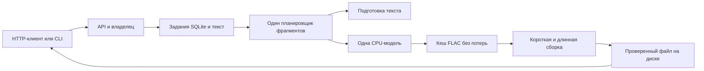

# Архитектура и разработка

[Проект](../../README.ru.md) · [Документация](../README.md) · [English](../en/development.md)

## Проследить запрос



Один процесс владеет моделью и соединением SQLite. Загрузка модели, подготовка ограниченных блоков текста и синтез используют один поток executor. Асинхронный планировщик чередует фрагменты разных заданий. SQLite обслуживается в цикле событий; поток модели не использует его соединение. Два потока кодирования дают отдельные слоты для короткого и длинного аудио; одновременно сборкой заняты не больше двух процессов FFmpeg.

| Исходник | Обязанность |
|---|---|
| `app/main.py` | Схемы запросов, авторизация владельца, HTTP-совместимость и отдача файлов |
| `app/service.py` | Очередь, контрольные точки, отмена, подготовка блоков и координация сборки |
| `app/store.py` | SQLite, приём заданий, целостность кеша, хранение и исключительное владение состоянием |
| `app/text.py` | Детерминированное произношение и проверка неподдерживаемого ввода |
| `app/engine.py` | Загрузка модели, фрагменты без потерь, потоковая сборка FFmpeg и проверка аудио |
| `app/config.py` | Настройки окружения и поддерживаемая модель/голоса |
| `client.py` | HTTP-клиент на стандартной библиотеке, ожидание и проверяемое продолжение скачивания |
| `scripts/` | Получение модели, запуск контейнера и smoke-проверка настоящего сервиса |

Исходный текст хранится на диске. Подготовка читает ограниченные UTF-8-блоки, сохраняет речевую копию и транзакционно добавляет упорядоченные фрагменты. Частичный индекс находит следующий незавершённый фрагмент без повторного просмотра готовых частей книги. Ключ части учитывает конфигурацию модели, версию нормализатора, словарь, голос и подготовленный текст. Скорость и итоговое кодирование отделены, чтобы смена формата использовала прежний синтез.

Успешный фрагмент атомарно переименовывается перед фиксацией в базе. SHA-256 кеша проверяется после рестарта или изменения метаданных файла, затем используется повторно внутри процесса, пока inode, размер и наносекундные времена изменения содержимого/метаданных совпадают. Повреждение общей части сбрасывает её готовность в незавершённых заданиях; часть создаётся заново. Это убирает повторное чтение и хеширование всех FLAC при использовании кеша и сборке.

Текущие файлы защищены до остановки своего потока, в том числе после отмены. Сборка потоково читает упорядоченные части и паузы, кодирует итог один раз, проверяет длительность/размер и вычисляет сумму. Целая звуковая дорожка книги не создаётся в RAM. При запуске удаляются незафиксированные временные артефакты. Схема SQLite внутренняя; сохраняй целое состояние и используй API вместо ручного редактирования базы.

## Запустить проверки

Для совпадения с образом и CI используй Python 3.13 и установи FFmpeg/ffprobe. Проверкам контрактов не нужны PyTorch, веса и внешние сервисы:

```sh
python3 -m venv .venv
.venv/bin/python -m pip install -r requirements.txt httpx==0.28.1
.venv/bin/python -m unittest discover -s tests -v
.venv/bin/python -m pip check
python3 client.py --help
```

Существующий набор использует изолированную детерминированную модель с настоящим кодированием FLAC/Opus/MP3/WAV. Проверяются API, разграничение владельцев, идемпотентность, большой UTF-8-текст, чередование заданий, повреждение кеша, гонки отмены, восстановление и бюджеты. Добавляй сюда регрессии важного поведения; отдельные одноразовые проверочные системы не нужны.

Настоящую модель проверяй через собранный образ и `scripts/smoke.py`. Перед выпуском изменений очереди/хранения проверяй восстановление длинного задания и короткий ответ во время большой работы. Используй искусственный текст, изолируй аварийные проверки от рабочей нагрузки, затем удаляй проверочные задания и файлы.

## Собрать и выпустить

`docker compose build` собирает CPU-образ; модель скачивается при запуске и хранится отдельно. Прямые Python-зависимости закреплены в `requirements.txt`, CPU Torch — в `Dockerfile`. Клиент использует только стандартную библиотеку.

Существующий процесс Container проверяет контракты и собирает образ при push/PR. Main публикует `latest` и тег коммита; теги версий — соответствующий образ. Тег `vX.Y.Z` должен совпадать с версиями API и CLI. После успешной сборки тега то же задание публикует `silero-tts.py` и `SHA256SUMS` в релизе GitHub. Перед развёртыванием проверь образ, файлы релиза и сумму клиента; закрепи полученный digest и выполни [обновление](operations.md).

Темы документации находятся в одинаковых языковых каталогах; [языковой указатель](../README.md) объясняет добавление перевода. При изменении контракта синхронизируй поведение и примеры. Условия модели описаны отдельно от MIT-лицензии Bridge.
